# Entity Relationships and Schema Architecture

This document provides a comprehensive, ground-truth reference for all entity relationships, foreign keys, cardinality, delete behaviors, and indexing rules implemented in the **Astronaut Health Monitoring System** as of Phase 3. 

It is constructed directly from the entity definitions in `Models/Entities/`, the Fluent API configurations in `Data/Configurations/`, and the EF Core migrations (`20261107022248_InitialCreate.cs` and `20261107033006_FixReferenceRangesAndTexts.cs`).

---

## 1. Summary Table of Relationships

| Parent Entity | Child Entity | Cardinality | Foreign Key Property | Nullable | On Delete Behavior | Short Purpose |
| :--- | :--- | :--- | :--- | :--- | :--- | :--- |
| `Missions` | `Astronauts` | One-to-Many (1:N) | `Astronaut.MissionId` | **Yes** | `SetNull` | Assigns an astronaut to an operational space mission; retains astronaut profile if mission is removed. |
| `Astronauts` | `VitalSignReadings` | One-to-Many (1:N) | `VitalSignReading.AstronautId` | **No** | `Cascade` | Associates recorded physiological telemetry readings with the monitored astronaut. |
| `Astronauts` | `SleepRecords` | One-to-Many (1:N) | `SleepRecord.AstronautId` | **No** | `Cascade` | Links sleep architecture and circadian stability records to the astronaut. |
| `Astronauts` | `MoodEntries` | One-to-Many (1:N) | `MoodEntry.AstronautId` | **No** | `Cascade` | Tracks psychological check-ins and subjective stress levels in isolation. |
| `Astronauts` | `Recommendations` | One-to-Many (1:N) | `Recommendation.AstronautId` | **No** | `Cascade` | Stores medical, activity, and dietary guidance directed to the astronaut. |
| `Astronauts` | `HealthAlerts` | One-to-Many (1:N) | `HealthAlert.AstronautId` | **No** | `Cascade` | Connects safety threshold alerts and clinical escalations to the affected astronaut. |
| `Astronauts` | `ChatMessages` | One-to-Many (1:N) | `ChatMessage.AstronautId` | **No** | `Cascade` | Acts as the thread key for ground monitor and astronaut bidirectional communication history. |
| `VitalSignTypes` | `VitalSignReadings` | One-to-Many (1:N) | `VitalSignReading.VitalSignTypeId` | **No** | `Restrict` | Classifies telemetry by metric type (HR, BP, SpO2, etc.); prevents deleting active types. |
| `VitalSignTypes` | `ReferenceRanges` | One-to-Many (1:N) | `ReferenceRange.VitalSignTypeId` | **No** | `Cascade` | Defines clinical and operational threshold limits (routine vs emergency) for the vital type. |
| `VitalSignTypes` | `HealthMetricGuides` | One-to-One (1:1) | `HealthMetricGuide.VitalSignTypeId` | **No** | `Cascade` | Provides 5-principle educational guidance on measurement and plain-language interpretation. |
| `VitalSignReadings` | `HealthAlerts` | One-to-Many (1:N) | `HealthAlert.VitalSignReadingId` | **Yes** | `SetNull` | References the exact telemetry reading that triggered the alert; preserves alert if reading is purged. |
| `EmergencyProcedures` | `HealthAlerts` | One-to-Many (1:N) | `HealthAlert.EmergencyProcedureId` | **Yes** | `SetNull` | Attaches immediate emergency countermeasure protocols to critical alerts. |
| `SpaceConditions` | `ConditionSymptoms` | One-to-Many (1:N) | `ConditionSymptom.ConditionId` | **No** | `Cascade` | Associative join linking space conditions to characteristic symptoms with weights. |
| `Symptoms` | `ConditionSymptoms` | One-to-Many (1:N) | `ConditionSymptom.SymptomId` | **No** | `Cascade` | Associative join connecting symptoms to space adaptation conditions. |
| `SpaceConditions` | `ConditionVitalSigns` | One-to-Many (1:N) | `ConditionVitalSign.ConditionId` | **No** | `Cascade` | Associative join defining expected vital sign shift directions (Low/High/Either) per condition. |
| `VitalSignTypes` | `ConditionVitalSigns` | One-to-Many (1:N) | `ConditionVitalSign.VitalSignTypeId` | **No** | `Restrict` | Associative join linking vital types to condition rules; prevents deleting vital types in active rules. |

---

## Detailed Relationship Catalog

### Mission & Astronaut Domain

#### 1. Mission -> Astronaut
- **Entities & Cardinality**: `Mission` (Parent) to `Astronaut` (Child), One-to-Many (1:N).
- **Foreign Key**: `Astronaut.MissionId` (`int?`), **Nullable**.
- **Navigations**:
  - Parent: `Mission.Astronauts` (`ICollection<Astronaut>`)
  - Child: `Astronaut.Mission` (`Mission?`)
- **Delete Behavior**: `DeleteBehavior.SetNull`
- **Configuration**: `AstronautConfiguration.cs` line 52:
  `builder.HasOne(a => a.Mission).WithMany(m => m.Astronauts).HasForeignKey(a => a.MissionId).OnDelete(DeleteBehavior.SetNull);`
- **Purpose**: Assigns an astronaut to an operational flight mission; if a mission is deleted or rescheduled, astronaut profiles are preserved with `MissionId = null`.

#### 2. Astronaut -> VitalSignReading
- **Entities & Cardinality**: `Astronaut` (Parent) to `VitalSignReading` (Child), One-to-Many (1:N).
- **Foreign Key**: `VitalSignReading.AstronautId` (`int`), **Non-nullable**.
- **Navigations**:
  - Parent: `Astronaut.VitalSignReadings` (`ICollection<VitalSignReading>`)
  - Child: `VitalSignReading.Astronaut` (`Astronaut`)
- **Delete Behavior**: `DeleteBehavior.Cascade`
- **Configuration**: `VitalSignReadingConfiguration.cs` line 64:
  `builder.HasOne(r => r.Astronaut).WithMany(a => a.VitalSignReadings).HasForeignKey(r => r.AstronautId).OnDelete(DeleteBehavior.Cascade);`
- **Purpose**: Associates physiological vital sign readings with the monitored astronaut.

#### 3. Astronaut -> SleepRecord
- **Entities & Cardinality**: `Astronaut` (Parent) to `SleepRecord` (Child), One-to-Many (1:N).
- **Foreign Key**: `SleepRecord.AstronautId` (`int`), **Non-nullable**.
- **Navigations**:
  - Parent: `Astronaut.SleepRecords` (`ICollection<SleepRecord>`)
  - Child: `SleepRecord.Astronaut` (`Astronaut`)
- **Delete Behavior**: `DeleteBehavior.Cascade`
- **Configuration**: `SleepRecordConfiguration.cs` line 35:
  `builder.HasOne(s => s.Astronaut).WithMany(a => a.SleepRecords).HasForeignKey(s => s.AstronautId).OnDelete(DeleteBehavior.Cascade);`
- **Purpose**: Links sleep duration, quality, and architecture records to the astronaut.

#### 4. Astronaut -> MoodEntry
- **Entities & Cardinality**: `Astronaut` (Parent) to `MoodEntry` (Child), One-to-Many (1:N).
- **Foreign Key**: `MoodEntry.AstronautId` (`int`), **Non-nullable**.
- **Navigations**:
  - Parent: `Astronaut.MoodEntries` (`ICollection<MoodEntry>`)
  - Child: `MoodEntry.Astronaut` (`Astronaut`)
- **Delete Behavior**: `DeleteBehavior.Cascade`
- **Configuration**: `MoodEntryConfiguration.cs` line 34:
  `builder.HasOne(m => m.Astronaut).WithMany(a => a.MoodEntries).HasForeignKey(m => m.AstronautId).OnDelete(DeleteBehavior.Cascade);`
- **Purpose**: Records psychological check-ins and subjective stress scores for the astronaut during mission isolation.

#### 5. Astronaut -> Recommendation
- **Entities & Cardinality**: `Astronaut` (Parent) to `Recommendation` (Child), One-to-Many (1:N).
- **Foreign Key**: `Recommendation.AstronautId` (`int`), **Non-nullable**.
- **Navigations**:
  - Parent: `Astronaut.Recommendations` (`ICollection<Recommendation>`)
  - Child: `Recommendation.Astronaut` (`Astronaut`)
- **Delete Behavior**: `DeleteBehavior.Cascade`
- **Configuration**: `RecommendationConfiguration.cs` line 44:
  `builder.HasOne(r => r.Astronaut).WithMany(a => a.Recommendations).HasForeignKey(r => r.AstronautId).OnDelete(DeleteBehavior.Cascade);`
- **Purpose**: Directs medical, activity, and environmental recommendations to a specific astronaut.

#### 6. Astronaut -> HealthAlert
- **Entities & Cardinality**: `Astronaut` (Parent) to `HealthAlert` (Child), One-to-Many (1:N).
- **Foreign Key**: `HealthAlert.AstronautId` (`int`), **Non-nullable**.
- **Navigations**:
  - Parent: `Astronaut.HealthAlerts` (`ICollection<HealthAlert>`)
  - Child: `HealthAlert.Astronaut` (`Astronaut`)
- **Delete Behavior**: `DeleteBehavior.Cascade`
- **Configuration**: `HealthAlertConfiguration.cs` line 50:
  `builder.HasOne(a => a.Astronaut).WithMany(ast => ast.HealthAlerts).HasForeignKey(a => a.AstronautId).OnDelete(DeleteBehavior.Cascade);`
- **Purpose**: Tracks safety threshold alerts and escalations triggered for the astronaut.

#### 7. Astronaut -> ChatMessage
- **Entities & Cardinality**: `Astronaut` (Parent) to `ChatMessage` (Child), One-to-Many (1:N).
- **Foreign Key**: `ChatMessage.AstronautId` (`int`), **Non-nullable**.
- **Navigations**:
  - Parent: `Astronaut.ChatMessages` (`ICollection<ChatMessage>`)
  - Child: `ChatMessage.Astronaut` (`Astronaut`)
- **Delete Behavior**: `DeleteBehavior.Cascade`
- **Configuration**: `ChatMessageConfiguration.cs` line 43:
  `builder.HasOne(c => c.Astronaut).WithMany(a => a.ChatMessages).HasForeignKey(c => c.AstronautId).OnDelete(DeleteBehavior.Cascade);`
- **Purpose**: Thread key: each astronaut maintains one unified support message thread with ground monitors.

---

### Vital Signs, References & Guides Domain

#### 8. VitalSignType -> VitalSignReading
- **Entities & Cardinality**: `VitalSignType` (Parent) to `VitalSignReading` (Child), One-to-Many (1:N).
- **Foreign Key**: `VitalSignReading.VitalSignTypeId` (`int`), **Non-nullable**.
- **Navigations**:
  - Parent: `VitalSignType.VitalSignReadings` (`ICollection<VitalSignReading>`)
  - Child: `VitalSignReading.VitalSignType` (`VitalSignType`)
- **Delete Behavior**: `DeleteBehavior.Restrict`
- **Configuration**: `VitalSignTypeConfiguration.cs` line 46:
  `builder.HasMany(v => v.VitalSignReadings).WithOne(r => r.VitalSignType).HasForeignKey(r => r.VitalSignTypeId).OnDelete(DeleteBehavior.Restrict);`
- **Purpose**: Categorizes vital readings by metric type (HR, BP, SpO2, etc.); restricts deletion if historical readings exist.

#### 9. VitalSignType -> ReferenceRange
- **Entities & Cardinality**: `VitalSignType` (Parent) to `ReferenceRange` (Child), One-to-Many (1:N).
- **Foreign Key**: `ReferenceRange.VitalSignTypeId` (`int`), **Non-nullable**.
- **Navigations**:
  - Parent: `VitalSignType.ReferenceRanges` (`ICollection<ReferenceRange>`)
  - Child: `ReferenceRange.VitalSignType` (`VitalSignType`)
- **Delete Behavior**: `DeleteBehavior.Cascade`
- **Configuration**: `VitalSignTypeConfiguration.cs` line 40:
  `builder.HasMany(v => v.ReferenceRanges).WithOne(r => r.VitalSignType).HasForeignKey(r => r.VitalSignTypeId).OnDelete(DeleteBehavior.Cascade);`
- **Purpose**: Defines baseline and operational threshold evaluation ranges across terrestrial and space scopes for the metric.

#### 10. VitalSignType -> HealthMetricGuide
- **Entities & Cardinality**: `VitalSignType` (Parent) to `HealthMetricGuide` (Child), One-to-One (1:1 / 1:0..1).
- **Foreign Key**: `HealthMetricGuide.VitalSignTypeId` (`int`), **Non-nullable**, enforced unique.
- **Navigations**:
  - Parent: `VitalSignType.HealthMetricGuide` (`HealthMetricGuide?`)
  - Child: `HealthMetricGuide.VitalSignType` (`VitalSignType`)
- **Delete Behavior**: `DeleteBehavior.Cascade`
- **Configuration**: `VitalSignTypeConfiguration.cs` line 34:
  `builder.HasOne(v => v.HealthMetricGuide).WithOne(g => g.VitalSignType).HasForeignKey<HealthMetricGuide>(g => g.VitalSignTypeId).OnDelete(DeleteBehavior.Cascade);`
- **Purpose**: Provides 5-core-principle educational guidance (What is it, Why it matters, How to measure, Interpretation, Immediate actions) tailored to astronauts.

---

### Alerts & Emergency Procedures Domain

#### 11. VitalSignReading -> HealthAlert
- **Entities & Cardinality**: `VitalSignReading` (Parent) to `HealthAlert` (Child), One-to-Many (1:N).
- **Foreign Key**: `HealthAlert.VitalSignReadingId` (`int?`), **Nullable**.
- **Navigations**:
  - Parent: `VitalSignReading.HealthAlerts` (`ICollection<HealthAlert>`)
  - Child: `HealthAlert.VitalSignReading` (`VitalSignReading?`)
- **Delete Behavior**: `DeleteBehavior.SetNull`
- **Configuration**: `HealthAlertConfiguration.cs` line 55:
  `builder.HasOne(a => a.VitalSignReading).WithMany(r => r.HealthAlerts).HasForeignKey(a => a.VitalSignReadingId).OnDelete(DeleteBehavior.SetNull);`
- **Purpose**: Pinpoints the exact sensor reading that triggered an alert; sets foreign key to `null` if the telemetry reading is purged to preserve the critical alert audit trail.

#### 12. EmergencyProcedure -> HealthAlert
- **Entities & Cardinality**: `EmergencyProcedure` (Parent) to `HealthAlert` (Child), One-to-Many (1:N).
- **Foreign Key**: `HealthAlert.EmergencyProcedureId` (`int?`), **Nullable**.
- **Navigations**:
  - Parent: `EmergencyProcedure.HealthAlerts` (`ICollection<HealthAlert>`)
  - Child: `HealthAlert.EmergencyProcedure` (`EmergencyProcedure?`)
- **Delete Behavior**: `DeleteBehavior.SetNull`
- **Configuration**: `HealthAlertConfiguration.cs` line 60:
  `builder.HasOne(a => a.EmergencyProcedure).WithMany(e => e.HealthAlerts).HasForeignKey(a => a.EmergencyProcedureId).OnDelete(DeleteBehavior.SetNull);`
- **Purpose**: Attaches actionable immediate emergency countermeasures to severe alerts; unlinks procedure if the protocol is retired.

---

### Symptom Guidance Domain (Many-to-Many via Join Entities)

#### 13. SpaceCondition <-> Symptom (via ConditionSymptom)
- **Entities & Cardinality**: Many-to-Many (M:N) decomposed into two One-to-Many (1:N) relationships via `ConditionSymptom`.
- **Join Entity Attributes**: `ConditionId` (`int`), `SymptomId` (`int`), `Weight` (`int`, default 1).
- **Foreign Keys**:
  - `ConditionSymptom.ConditionId` -> `SpaceConditions.Id` (**Non-nullable**)
  - `ConditionSymptom.SymptomId` -> `Symptoms.Id` (**Non-nullable**)
- **Navigations**:
  - `SpaceCondition.ConditionSymptoms` (`ICollection<ConditionSymptom>`) <-> `ConditionSymptom.Condition` (`SpaceCondition`)
  - `Symptom.ConditionSymptoms` (`ICollection<ConditionSymptom>`) <-> `ConditionSymptom.Symptom` (`Symptom`)
- **Delete Behavior**: `DeleteBehavior.Cascade` on both sides.
- **Configuration**: `ConditionSymptomConfiguration.cs` lines 18-26.
- **Index**: Unique composite index on `(ConditionId, SymptomId)`.
- **Purpose**: Connects subjective/observable symptoms to space adaptation conditions with relative weighting for non-diagnostic topic matching.

#### 14. SpaceCondition <-> VitalSignType (via ConditionVitalSign)
- **Entities & Cardinality**: Many-to-Many (M:N) decomposed into two One-to-Many (1:N) relationships via `ConditionVitalSign`.
- **Join Entity Attributes**: `ConditionId` (`int`), `VitalSignTypeId` (`int`), `Direction` (`VitalSignDirection` enum string: Low/High/Either), `ContextNote` (`string?`, max 500).
- **Foreign Keys**:
  - `ConditionVitalSign.ConditionId` -> `SpaceConditions.Id` (**Non-nullable**)
  - `ConditionVitalSign.VitalSignTypeId` -> `VitalSignTypes.Id` (**Non-nullable**)
- **Navigations**:
  - `SpaceCondition.ConditionVitalSigns` (`ICollection<ConditionVitalSign>`) <-> `ConditionVitalSign.Condition` (`SpaceCondition`)
  - `VitalSignType.ConditionVitalSigns` (`ICollection<ConditionVitalSign>`) <-> `ConditionVitalSign.VitalSignType` (`VitalSignType`)
- **Delete Behavior**:
  - `ConditionId`: `DeleteBehavior.Cascade`
  - `VitalSignTypeId`: `DeleteBehavior.Restrict` (safeguards vital sign types from accidental deletion while referenced in condition rules)
- **Configuration**: `ConditionVitalSignConfiguration.cs` lines 25-33.
- **Index**: Non-unique composite index on `(ConditionId, VitalSignTypeId)`.
- **Purpose**: Defines expected vital sign deviation directions and situational clinical context (e.g., "mainly when standing") for space conditions.

---

## 2. Complete Mermaid Entity-Relationship Diagram

```mermaid
erDiagram
    Missions ||--o{ Astronauts : "assigns (0..1 to 0..N)"
    Astronauts ||--o{ VitalSignReadings : "records (1 to 0..N)"
    Astronauts ||--o{ SleepRecords : "logs (1 to 0..N)"
    Astronauts ||--o{ MoodEntries : "logs (1 to 0..N)"
    Astronauts ||--o{ Recommendations : "receives (1 to 0..N)"
    Astronauts ||--o{ HealthAlerts : "triggers (1 to 0..N)"
    Astronauts ||--o{ ChatMessages : "participates_in (1 to 0..N)"

    VitalSignTypes ||--o{ VitalSignReadings : "categorizes (1 to 0..N)"
    VitalSignTypes ||--o{ ReferenceRanges : "defines_thresholds (1 to 0..N)"
    VitalSignTypes ||--o| HealthMetricGuides : "explains (1 to 0..1)"

    VitalSignReadings ||--o{ HealthAlerts : "generates (0..1 to 0..N)"
    EmergencyProcedures ||--o{ HealthAlerts : "attaches_protocol (0..1 to 0..N)"

    SpaceConditions ||--o{ ConditionSymptoms : "associates (1 to 0..N)"
    Symptoms ||--o{ ConditionSymptoms : "links_to (1 to 0..N)"

    SpaceConditions ||--o{ ConditionVitalSigns : "associates (1 to 0..N)"
    VitalSignTypes ||--o{ ConditionVitalSigns : "expects_deviation (1 to 0..N)"

    Missions {
        int Id PK
        string Code UK "Unique mission code (e.g. ARES-III)"
        string Name
        string Destination
        timestamp StartDate
        timestamp EndDate
        string Status
        timestamp CreatedAt
        timestamp UpdatedAt
    }

    Astronauts {
        int Id PK
        int MissionId FK "Nullable (SetNull on delete)"
        string AstronautCode UK "Unique identifier (e.g. AST-042)"
        string FirstName
        string LastName
        string FullName "Indexed for dashboard search"
        string UserId "Nullable stored string link for Phase 4 Auth"
        timestamp DateOfBirth
        string Gender
        string BloodType
        double HeightCm
        double WeightKg
        string EmergencyContactInfo
        timestamp CreatedAt
        timestamp UpdatedAt
    }

    VitalSignTypes {
        int Id PK
        string Code UK "Unique code (HR, BP, SPO2, TEMP, GLUCOSE, RESP)"
        string Name
        string Unit "bpm, mmHg, %, °C, mg/dL, breaths/min"
        string Description
        timestamp CreatedAt
        timestamp UpdatedAt
    }

    VitalSignReadings {
        int Id PK
        uuid ClientGeneratedId UK "Unique offline-sync idempotency key"
        int AstronautId FK "Cascade on delete"
        int VitalSignTypeId FK "Restrict on delete"
        timestamp RecordedAt "Device capture timestamp"
        double Value "Primary measured metric"
        double SecondaryValue "Paired metric (e.g. Diastolic BP)"
        string Status "Routine, MedicalAttention, Emergency"
        string MeasurementMethod
        string SensorLocation
        string BodyPosition
        string ActivityContext
        string DataQuality
        string MealContext
        int MinutesSinceLastMeal
        string DeviceId
        string Notes
        timestamp CreatedAt
        timestamp UpdatedAt
    }

    ReferenceRanges {
        int Id PK
        int VitalSignTypeId FK "Cascade on delete"
        double MinNormal
        double MaxNormal
        double EmergencyBelow "Nullable emergency threshold"
        double EmergencyAbove "Nullable emergency threshold"
        double MinSecondaryNormal "Nullable secondary metric range"
        double MaxSecondaryNormal "Nullable secondary metric range"
        double SecondaryEmergencyBelow "Nullable secondary emergency"
        double SecondaryEmergencyAbove "Nullable secondary emergency"
        string ApplicableGender
        int MinAge
        int MaxAge
        string Source "NASA-STD-3001, Terrestrial Clinical Standards"
        string Scope "EarthGeneral, SpaceflightStandard"
        boolean IsMissionApproved
        string ReviewedBy
        timestamp ReviewedAt
        string Notes
        boolean IsActive
        timestamp CreatedAt
        timestamp UpdatedAt
    }

    HealthMetricGuides {
        int Id PK
        int VitalSignTypeId FK,UK "1:1 unique constraint (Cascade on delete)"
        string WhatIsIt "Principle 1"
        string WhyItMatters "Principle 2"
        string HowToMeasure "Principle 3"
        string InterpretationGuidance "Principle 4"
        string ActionGuidance "Principle 5"
        timestamp CreatedAt
        timestamp UpdatedAt
    }

    EmergencyProcedures {
        int Id PK
        string Code UK "Unique code (e.g. EP-HYPOXIA-01)"
        string Title
        string TargetCondition
        string Severity
        string ImmediateAction
        string StepByStepInstructions
        string RequiredEquipment
        string GuidanceNotes
        timestamp CreatedAt
        timestamp UpdatedAt
    }

    HealthAlerts {
        int Id PK
        int AstronautId FK "Cascade on delete"
        int VitalSignReadingId FK "Nullable (SetNull on delete)"
        int EmergencyProcedureId FK "Nullable (SetNull on delete)"
        string Severity "Routine, MedicalAttention, Emergency"
        string Title
        string Message
        string Reason
        string ActionRequired
        timestamp TriggeredAt
        timestamp AcknowledgedAt
        string AcknowledgedBy
        string ActionTaken
        string Status "Active, Acknowledged, Dismissed, Resolved"
        boolean IsDelayed
        timestamp CreatedAt
        timestamp UpdatedAt
    }

    SleepRecords {
        int Id PK
        uuid ClientGeneratedId UK "Unique offline-sync idempotency key"
        int AstronautId FK "Cascade on delete"
        timestamp RecordedAt
        timestamp StartTime
        timestamp EndTime
        double DurationHours
        string Quality
        int DeepSleepMinutes
        int RemSleepMinutes
        int LightSleepMinutes
        int AwakeMinutes
        double SleepEfficiencyPercentage
        string Notes
        timestamp CreatedAt
        timestamp UpdatedAt
    }

    MoodEntries {
        int Id PK
        uuid ClientGeneratedId UK "Unique offline-sync idempotency key"
        int AstronautId FK "Cascade on delete"
        timestamp RecordedAt
        int MoodScore
        int StressLevel
        string DominantEmotion
        string Notes
        timestamp CreatedAt
        timestamp UpdatedAt
    }

    Recommendations {
        int Id PK
        int AstronautId FK "Cascade on delete"
        timestamp GeneratedAt
        string Title
        string Content
        string Reason
        string Category
        string Priority
        string Status
        timestamp ActionDueDate
        timestamp CreatedAt
        timestamp UpdatedAt
    }

    ChatMessages {
        int Id PK
        uuid ClientGeneratedId UK "Unique offline-sync idempotency key"
        int AstronautId FK "Thread key (Cascade on delete)"
        string SenderUserId
        string SenderRole "Astronaut, Monitor"
        string Content
        timestamp RecordedAt
        timestamp SentAt
        timestamp ReadAt
        timestamp CreatedAt
        timestamp UpdatedAt
    }

    SpaceConditions {
        int Id PK
        string Code UK "Unique code (e.g. ORTHOSTATIC_INTOLERANCE)"
        string Name
        string Description
        string SelfCareGuidance
        string WhenToContactMonitor
        string SourceReference
        boolean IsMatchable
        string Notes
        timestamp CreatedAt
        timestamp UpdatedAt
    }

    Symptoms {
        int Id PK
        string Code UK "Unique code (e.g. FAINTING, CHEST_PAIN)"
        string Name
        string BodyArea
        boolean IsRedFlag
        timestamp CreatedAt
        timestamp UpdatedAt
    }

    ConditionSymptoms {
        int Id PK
        int ConditionId FK "Cascade on delete"
        int SymptomId FK "Cascade on delete"
        int Weight "Default 1"
        timestamp CreatedAt
        timestamp UpdatedAt
    }

    ConditionVitalSigns {
        int Id PK
        int ConditionId FK "Cascade on delete"
        int VitalSignTypeId FK "Restrict on delete"
        string Direction "Low, High, Either"
        string ContextNote
        timestamp CreatedAt
        timestamp UpdatedAt
    }
```

---

## 3. Unique and Composite Indexes

The database schema utilizes indexes to enforce uniqueness constraints, guarantee offline synchronization idempotency, and optimize performance for time-series and filtered dashboard queries.

### A. Natural Key & Unique Indexes
- **`Missions.Code`** (`IX_Missions_Code`): Unique index ensuring mission codes are unique system-wide.
- **`Astronauts.AstronautCode`** (`IX_Astronauts_AstronautCode`): Unique index for quick monitor lookup and crew member identification.
- **`VitalSignTypes.Code`** (`IX_VitalSignTypes_Code`): Unique index for vital sign acronym identifiers (`HR`, `BP`, `SPO2`, etc.).
- **`EmergencyProcedures.Code`** (`IX_EmergencyProcedures_Code`): Unique index on procedure identifiers (`EP-HYPOXIA-01`).
- **`SpaceConditions.Code`** (`IX_SpaceConditions_Code`): Unique index on condition codes (`ORTHOSTATIC_INTOLERANCE`).
- **`Symptoms.Code`** (`IX_Symptoms_Code`): Unique index on symptom codes (`CHEST_PAIN`, `DIZZINESS`).
- **`HealthMetricGuides.VitalSignTypeId`** (`IX_HealthMetricGuides_VitalSignTypeId`): Unique index enforcing the strict 1:1 relationship with `VitalSignType`.

### B. Offline-Sync Idempotency Keys (ClientGeneratedId)
All telemetry and messaging tables originating on client devices enforce a unique constraint on `ClientGeneratedId`. This allows offline batch synchronization to perform safe idempotency checks (`INSERT ... ON CONFLICT DO NOTHING`):
- **`VitalSignReadings.ClientGeneratedId`** (`IX_VitalSignReadings_ClientGeneratedId`): Unique index.
- **`SleepRecords.ClientGeneratedId`** (`IX_SleepRecords_ClientGeneratedId`): Unique index.
- **`MoodEntries.ClientGeneratedId`** (`IX_MoodEntries_ClientGeneratedId`): Unique index.
- **`ChatMessages.ClientGeneratedId`** (`IX_ChatMessages_ClientGeneratedId`): Unique index.

### C. Composite Performance Indexes
- **`VitalSignReadings (AstronautId, RecordedAt)`** (`IX_VitalSignReadings_AstronautId_RecordedAt`): Optimizes time-series range queries and dashboard telemetry charts per astronaut.
- **`SleepRecords (AstronautId, RecordedAt)`** (`IX_SleepRecords_AstronautId_RecordedAt`): Optimizes circadian rhythm and sleep history loading for an astronaut.
- **`MoodEntries (AstronautId, RecordedAt)`** (`IX_MoodEntries_AstronautId_RecordedAt`): Optimizes psychological check-in history queries.
- **`ChatMessages (AstronautId, SentAt)`** (`IX_ChatMessages_AstronautId_SentAt`): Optimizes chronological message retrieval within an astronaut's unified ground support thread.
- **`HealthAlerts (AstronautId, Status, TriggeredAt)`** (`IX_HealthAlerts_AstronautId_Status_TriggeredAt`): Optimizes dashboard queries filtering active alerts per astronaut ordered by timestamp.
- **`Recommendations (AstronautId, Status)`** (`IX_Recommendations_AstronautId_Status`): Speeds up retrieval of pending recommendations for crew members.
- **`ReferenceRanges (VitalSignTypeId, Scope, IsActive)`** (`IX_ReferenceRanges_VitalSignTypeId_Scope_IsActive`): Optimizes alert engine evaluation queries matching active thresholds for a given metric and operational scope.
- **`ConditionSymptoms (ConditionId, SymptomId)`** (`IX_ConditionSymptoms_ConditionId_SymptomId`): **Unique composite index** ensuring a symptom cannot be associated twice with the same space condition.
- **`ConditionVitalSigns (ConditionId, VitalSignTypeId)`** (`IX_ConditionVitalSigns_ConditionId_VitalSignTypeId`): Non-unique composite index facilitating lookup of expected vital deviations for a space condition.

### D. Single-Column Lookup Indexes
- **`Astronauts.FullName`** (`IX_Astronauts_FullName`): Supports fast case-insensitive search queries on monitor consoles.
- **`Astronauts.UserId`** (`IX_Astronauts_UserId`): Indexed to facilitate future identity lookups in Phase 4.
- **Foreign Key Indexes**: EF Core automatically generates individual indexes on all foreign key columns (`MissionId`, `VitalSignTypeId`, `SymptomId`, `VitalSignReadingId`, `EmergencyProcedureId`).

---

## 4. "Not Related by Design" List

The following entity pairs intentionally do NOT maintain direct foreign key relationships in the database:

1. **`Astronaut` and `Identity User` (`UserId`)**:
   - `Astronaut.UserId` is stored as an unconstrained, nullable string (`HasMaxLength(450)`). There is no foreign key to an `AspNetUsers` table.
   - *Design Reason*: Decouples the core physiological medical domain from authentication infrastructure. Identity and JWT authorization are introduced in Phase 4.
2. **`ChatMessage` and `SenderUserId`**:
   - Stores `SenderUserId` as a raw string alongside `SenderRole` ("Astronaut" or "Monitor") rather than an FK to an Identity User.
   - *Design Reason*: Enables offline queuing of messages and uniform thread management without requiring local user rows to exist in edge environments.
3. **`ChatMessage` and `Mission`**:
   - Messages are partitioned strictly by `AstronautId` (`IX_ChatMessages_AstronautId_SentAt`), not by `MissionId`.
   - *Design Reason*: Each astronaut maintains one lifelong, unified health and operational support thread with ground monitors that persists across mission assignments, pre-flight training, and post-flight rehabilitation.
4. **`HealthAlert` and `SpaceCondition`**:
   - `HealthAlert` contains foreign keys only to `VitalSignReading` and `EmergencyProcedure`, but never to `SpaceCondition`.
   - *Design Reason*: The alert engine is strictly deterministic and threshold-based. Safety alerts notify staff of physiological threshold breaches; they never assign diagnostic labels or link to spaceflight adaptation conditions. Space condition matching is an educational, non-diagnostic guidance tool handled separately in the Symptom Guidance module.
5. **`ReferenceRange` and `Astronaut`**:
   - `ReferenceRange` applies globally per `VitalSignType` and `ReferenceRangeScope` (EarthGeneral, SpaceflightStandard). It has no `AstronautId`.
   - *Design Reason*: The MVP uses standard reference thresholds. Personalized crew baselines are deferred to the `PersonalBaseline` entity in Phase 5.
6. **`EmergencyProcedure` and `VitalSignType`**:
   - `EmergencyProcedure` links to `HealthAlert`, but does not have a direct foreign key to `VitalSignType`.
   - *Design Reason*: An emergency condition (e.g., severe hypoxia, toxic atmosphere) is a multi-system emergency protocol that may involve multiple vital sign indicators or ambient environmental triggers.
7. **`SleepRecord` / `MoodEntry` and `VitalSignReading`**:
   - Telemetry streams are captured independently and intentionally decoupled at the relational schema level.
   - *Design Reason*: Wearables and astronaut inputs record data asynchronously with differing sample rates. Telemetry correlation is handled at the application query level via `AstronautId` and `RecordedAt` time windows rather than rigid relational foreign keys.
8. **`Recommendation` and `HealthAlert`**:
   - Recommendations do not link to alerts.
   - *Design Reason*: Recommendations represent non-urgent, chronic or preventive guidance (dietary adjustments, exercise reminders, circadian alignment) and are managed on a distinct workflow from immediate safety alarms.
9. **`Symptom` / `SpaceCondition` and `Astronaut`**:
   - Neither `Symptom` nor `SpaceCondition` has an `AstronautId`.
   - *Design Reason*: In Phase 2b, these entities serve purely as catalog and guidance tables. Individual crew symptom episode tracking is deferred to `SymptomLog` in Phase 5.7.
10. **`HealthMetricGuide` and `ReferenceRange`**:
    - Both entities reference `VitalSignType`, but have no direct link between each other.
    - *Design Reason*: `HealthMetricGuide` contains qualitative educational text (how to place sensors, plain-language meaning), whereas `ReferenceRange` holds quantitative numerical thresholds evaluated dynamically by the alert engine.

---

## 5. "Planned, Not Yet in Code" List

The following entities and relationships exist in backlog specifications (`Models/Backlog/`) or roadmap phases, but are intentionally excluded from the active EF Core DbContext and database schema:

1. **`SymptomLog` (`Models/Backlog/Entities/SymptomLog.cs`)**:
   - **Target Phase**: Phase 5.7.
   - **Planned Relationships**:
     - `Astronaut` -> `SymptomLog` (One-to-Many, mandatory `AstronautId`, Cascade delete).
     - `VitalSignReading` -> `SymptomLog` (One-to-Many, optional `RelatedVitalSignReadingId`, SetNull delete) to correlate subjective symptom reports with concurrent wearable sensor readings.
2. **`PersonalBaseline` (`Models/Backlog/Entities/PersonalBaseline.cs`)**:
   - **Target Phase**: Phase 5 (Advanced Telemetry & Analytics).
   - **Planned Relationships**:
     - `Astronaut` -> `PersonalBaseline` (One-to-Many).
     - `VitalSignType` -> `PersonalBaseline` (One-to-Many).
     - Allows ground monitors to establish personalized baseline resting heart rates, blood pressure, and circadian norms per astronaut.
3. **`ApplicationUser` / Identity User (`Microsoft.AspNetCore.Identity`)**:
   - **Target Phase**: Phase 4 (Authentication & Role-Based Access Control).
   - **Planned Relationships**:
     - `AspNetUsers` -> `Astronaut` (1:1 link via `Astronaut.UserId`).
     - `AspNetUsers` -> `ChatMessage` (1:N link via `ChatMessage.SenderUserId`).
4. **`ExerciseLog` & `PhysicalActivity` (`Models/Backlog/Entities/ExerciseLog.cs`, `PhysicalActivity.cs`)**:
   - **Target Phase**: Phase 5.
   - **Planned Relationships**: `Astronaut` -> `ExerciseLog` (One-to-Many) for tracking daily countermeasure exercise (cycle ergometer, ARED resistance training, T2 treadmill).
5. **`RadiationDoseRecord` (`Models/Backlog/Entities/RadiationDoseRecord.cs`)**:
   - **Target Phase**: Phase 5.
   - **Planned Relationships**: `Astronaut` -> `RadiationDoseRecord` (One-to-Many) tracking cumulative deep space ionizing radiation exposure.
6. **`HydrationNutritionLog` (`Models/Backlog/Entities/HydrationNutritionLog.cs`)**:
   - **Target Phase**: Phase 5.
   - **Planned Relationships**: `Astronaut` -> `HydrationNutritionLog` (One-to-Many) tracking caloric, macronutrient, and fluid balance.
7. **`MedicalCheckup` & `MedicalHistoryEntry` (`Models/Backlog/Entities/MedicalCheckup.cs`)**:
   - **Target Phase**: Phase 5.
   - **Planned Relationships**: `Astronaut` -> `MedicalCheckup` (One-to-Many) for periodic clinical exams conducted by the crew medical officer.
8. **`FatigueEntry` & `PvtTestResult` (`Models/Backlog/Entities/FatigueEntry.cs`, `PvtTestResult.cs`)**:
   - **Target Phase**: Phase 5.
   - **Planned Relationships**: `Astronaut` -> `FatigueEntry` / `PvtTestResult` (One-to-Many) tracking cognitive reaction times and psychomotor vigilance scores.
9. **`EnvironmentStatus` & `EmergencyIncident` (`Models/Backlog/Entities/EnvironmentStatus.cs`, `EmergencyIncident.cs`)**:
   - **Target Phase**: Phase 5.
   - **Planned Relationships**: `Mission` -> `EnvironmentStatus` (One-to-Many) and `Mission` -> `EmergencyIncident` (One-to-Many) for spacecraft cabin sensor telemetry (CO2 partial pressure, atmospheric pressure, O2 level, ambient temperature).

---

## 6. Discrepancies and Behavioral Nuances

This section explicitly verifies the expected relationships against the actual codebase implementation and highlights specific behavioral nuances:

### Verification of Expected Relationships

| Expected Relationship | In Code? | Actual Implementation Status |
| :--- | :---: | :--- |
| **Mission -> Astronaut** (1:N, `Astronaut.MissionId` nullable) | **YES** | Configured in `AstronautConfiguration.cs`. Foreign key is nullable (`int?`), delete behavior is `DeleteBehavior.SetNull`. |
| **Astronaut -> VitalSignReading, SleepRecord, MoodEntry, Recommendation, HealthAlert, ChatMessage** (1:N) | **YES** | All 6 relationships are fully configured with mandatory foreign key `AstronautId` (`int`) and `DeleteBehavior.Cascade`. |
| **VitalSignType -> VitalSignReading, ReferenceRange** (1:N) | **YES** | Configured in `VitalSignTypeConfiguration.cs`. `ReferenceRange` has `DeleteBehavior.Cascade`; `VitalSignReading` has `DeleteBehavior.Restrict` to protect telemetry records. |
| **VitalSignType -> HealthMetricGuide** (1:1 / 1:0..1) | **YES** | Configured in `VitalSignTypeConfiguration.cs` with `HasForeignKey<HealthMetricGuide>(g => g.VitalSignTypeId)` and `DeleteBehavior.Cascade`. Produces a unique index on `VitalSignTypeId`. |
| **VitalSignReading -> HealthAlert** (1:N, nullable FK) | **YES** | Configured in `HealthAlertConfiguration.cs`. Foreign key `VitalSignReadingId` is `int?` (nullable), delete behavior is `DeleteBehavior.SetNull`. |
| **EmergencyProcedure -> HealthAlert** (1:N, nullable FK) | **YES** | Configured in `HealthAlertConfiguration.cs`. Foreign key `EmergencyProcedureId` is `int?` (nullable), delete behavior is `DeleteBehavior.SetNull`. |
| **SpaceCondition <-> Symptom** (M:N via ConditionSymptom, with Weight) | **YES** | Configured in `ConditionSymptomConfiguration.cs`. Includes `Weight` (default 1), unique composite index on `(ConditionId, SymptomId)`, and `DeleteBehavior.Cascade` on both foreign keys. |
| **SpaceCondition <-> VitalSignType** (M:N via ConditionVitalSign, with Direction and ContextNote) | **YES** | Configured in `ConditionVitalSignConfiguration.cs`. Includes `Direction` (enum string), `ContextNote` (`string?`), `Cascade` delete on `ConditionId`, and `Restrict` delete on `VitalSignTypeId`. |
| **Astronaut.UserId links to Identity user** (stored id for now, no FK) | **YES** | Present as `public string? UserId { get; set; }` in `Astronaut.cs`. Indexed in `AstronautConfiguration.cs` without foreign key constraint. |

### Notable Behavioral Nuances

1. **Delete Behavior Asymmetry in Many-to-Many Tables**:
   - `ConditionSymptom` uses `DeleteBehavior.Cascade` for both `ConditionId` and `SymptomId`. Deleting either a condition or a symptom automatically clears the association row.
   - In contrast, `ConditionVitalSign` uses `DeleteBehavior.Cascade` on `ConditionId`, but `DeleteBehavior.Restrict` on `VitalSignTypeId`. This guarantees that an operational vital sign type cannot be deleted from the database if it is currently tied to a space condition evaluation rule.
2. **Composite Index Uniqueness Differences in Join Tables**:
   - `ConditionSymptoms` has a **unique** composite index: `builder.HasIndex(cs => new { cs.ConditionId, cs.SymptomId }).IsUnique();`.
   - `ConditionVitalSigns` has a **non-unique** composite index: `builder.HasIndex(cv => new { cv.ConditionId, cv.VitalSignTypeId });` (does not call `.IsUnique()`). While a condition typically associates with a vital sign once, the database constraint itself permits multiple directional context entries if needed.
3. **Runtime Nullability in 1:1 `HealthMetricGuide`**:
   - At the relational database level, `HealthMetricGuide.VitalSignTypeId` is non-nullable and unique, enforcing strict 1:1 integrity.
   - However, in C# entity navigation, `VitalSignType.HealthMetricGuide` is typed as nullable (`HealthMetricGuide?`). This makes the relationship effectively `1:0..1` (one-to-zero-or-one) at runtime, allowing a `VitalSignType` to be instantiated prior to its guide being populated.
4. **Audit Trail Preservation on Alerts**:
   - Both foreign keys on `HealthAlert` (`VitalSignReadingId` and `EmergencyProcedureId`) are configured with `DeleteBehavior.SetNull`. This architectural safeguard ensures that pruning older raw telemetry readings or archiving deprecated emergency procedures will never cascade-delete critical medical alert history.

